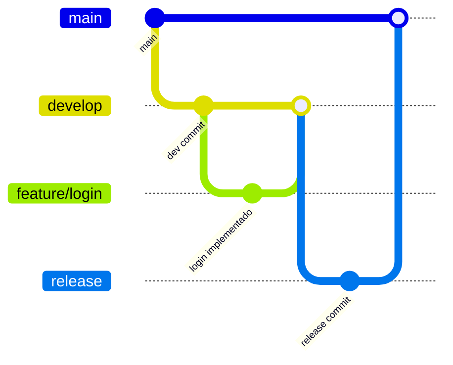

# 📦 Projeto Iris

O projeto Iris visa em ser um projeto em miniatura de uma simulação de uma rede social utilizando React com Flask dentro de um cluster GKE da Google Cloud.

---

## 🚀 Tecnologias Utilizadas

* React / Flask.
* Docker
* GitHub Actions.
* Banco de Dados: PostgreSQL.
* Google Kubernetes Engine (GKE).
* Terraform (para infraestrutura como código).
* Prometheus e Grafana (para monitoramento dos clusters).

---

## 🔄 Arquitetura Multinuvem

O projeto Iris foi estruturado para operar em uma arquitetura multinuvem, com dois ambientes totalmente isolados: **Produção** e **Homologação (Stage)**. Cada ambiente está provisionado em uma nuvem distinta, garantindo maior robustez, disponibilidade e aderência a práticas modernas de desenvolvimento e operações.

As principais implementações realizadas foram:

* **Provisionamento de dois clusters Kubernetes**, um para Produção e outro para Stage, utilizando **Terraform** para gestão da infraestrutura como código.
* **Implementação de monitoramento com Prometheus e Grafana** em ambos os clusters, permitindo a visualização de métricas como uso de CPU, memória e status dos pods.
* Criação de **dashboards no Grafana**, oferecendo uma visão clara e em tempo real da saúde dos clusters.
* Estruturação de **duas pipelines de CI/CD independentes com GitHub Actions**, responsáveis por:

  * Provisionamento completo da infraestrutura.
  * Build e push das imagens Docker para o Artifact Registry.
  * Deploy da aplicação (frontend e backend) nos respectivos clusters.
  * Aplicação dos manifests Kubernetes e Helm Charts (quando aplicável).
* **Validação automatizada dos deploys**, garantindo que as aplicações estejam operando corretamente em cada ambiente.

---

## 🌱 Fluxo de Branches



---

### ⚙️ Estrutura do Pipeline

Este projeto utiliza **GitHub Actions** para automatizar testes, build e deploy da aplicação em produção e homologação. O pipeline está dividido em três jobs principais:

#### 1. `test`

* Executado em pushes para a branch `main`.
* Realiza:

  * Checkout do repositório
  * Configuração do Node.js (versão 18)
  * Instalação das dependências com `npm ci`
  * Execução dos testes com `npm test`

#### 2. `build`

* É disparado após o job `test`.
* Etapas:

  * Configuração do plugin gke-gcloud-auth
  * Autenticação com Google Cloud via secrets
  * Build e push da imagem Docker para o Artifact Registry

#### 3. `deploy`

* Realiza:

  * Deploy no GKE (Produção ou Stage, dependendo da branch)
  * Aplicação dos manifests Kubernetes
  * Configuração do monitoramento no cluster (Prometheus + Grafana)

#### 4. `release`

* Push para a branch `release` envia automaticamente uma notificação por e-mail sobre a nova versão.

---

### 💻 Instruções para rodar localmente

**Pré-requisitos:**

* Node.js 18+
* Docker (opcional)
* `.env` com as seguintes variáveis:

```env
VITE_API_URL=http://localhost:3000/api
VITE_ENCRYPTION_KEY=sua-chave-secreta
```

```bash
git clone https://github.com/WEBcko/iris-frontend.git
cd iris-frontend
npm install
npm run dev
```

---

### 🚢 Deploy em Produção

O deploy é feito automaticamente via **GitHub Actions**, conforme definido no arquivo `.github/workflows/main.yml`.

**Passos:**

1. Realize o **merge** da branch `develop` para `main`.
2. A pipeline será executada automaticamente com as seguintes etapas:

   * Provisionamento da infraestrutura via Terraform (se necessário)
   * Build da imagem Docker
   * Push para o Artifact Registry do Google
   * Autenticação com GKE
   * Aplicação dos manifests no cluster
   * Deploy e configuração do monitoramento
   ---
